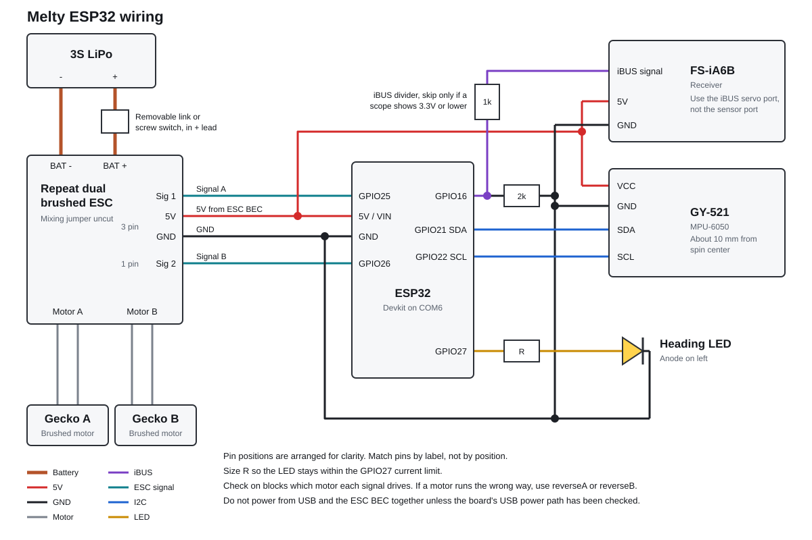

# Melty-ESP32

ESP32 firmware for a two-motor brushed melty brain combat robot. The whole robot spins, and the firmware times a power change to each motor once per rotation so the robot can drive while spinning.

Built for the [KSU Combat Robotics 1lb Antweight](https://www.ksucombat.club/events/1lb) event on February 27, 2027.

> **Warning:** Only the bare ESP32 has run this firmware so far. Arming, ESC output, translation, and flip handling are untested on hardware. Do not free-run or fight the robot until the failsafe test in the [bench guide](docs/bench-guide.md) passes.

## Hardware

| Part | Used |
| --- | --- |
| Controller | Classic ESP32 devkit |
| Radio | FlySky FS-i6 with FS-iA6B receiver, over iBUS |
| Motors | 2x DartBox V2 Gecko brushed gearmotors |
| ESC | Repeat Robotics dual brushed ESC for ant drive, mixing jumper uncut |
| Sensor | GY-521 MPU-6050, accelerometer only |
| Battery | 3S LiPo |
| Extras | Heading LED, removable link or screw switch |



## Controls

| Control | Channel | Purpose |
| --- | --- | --- |
| Right stick | CH1, CH2 | Drive direction and amount |
| Left stick vertical | CH3 | Spin speed |
| Left stick horizontal | CH4 | Heading trim |
| SwA | CH5 | Arm and disarm |

To arm, hold the left stick down and the right stick full left, then flip SwA to armed.

## Failsafes

- **Radio:** set CH3 and CH5 failsafes on the i6 to spin minimum and disarmed.
- **Firmware:** motors go to neutral on lost iBUS, bad channel data, or disarm. A failsafe or reboot requires the full arming sequence again.
- **ESC:** pulses need a running CPU, so a crash stops the signal and the ESC's signal-loss stop takes over.

How the FS-iA6B behaves over iBUS on signal loss is unconfirmed. The failsafe test settles it on real hardware.

## Build

Requires [PlatformIO](https://platformio.org/).

```sh
pio run -e esp32              # build
pio run -e esp32 -t upload    # flash, set to COM6 in platformio.ini
pio test -e native            # host tests, needs a host C++ compiler
```

Settings are tuned over USB at 115200 baud while disarmed. See the [bench guide](docs/bench-guide.md) for commands.

## Docs

- [Bench guide](docs/bench-guide.md): parts, wiring, i6 setup, calibration, and test steps
- [Design](docs/superpowers/specs/2026-10-30-melty-esp32-design.md)
